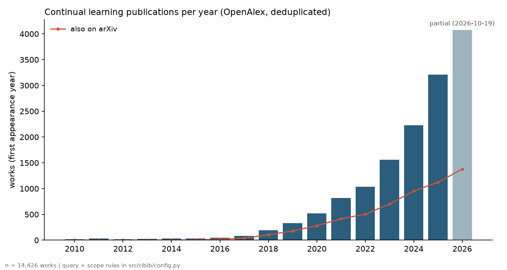
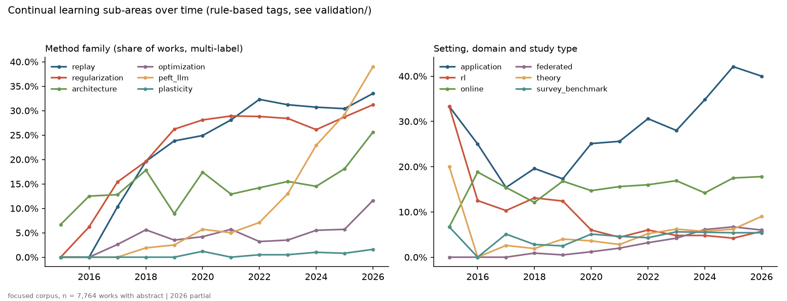
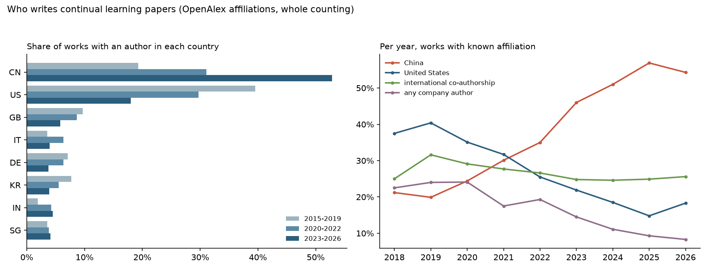
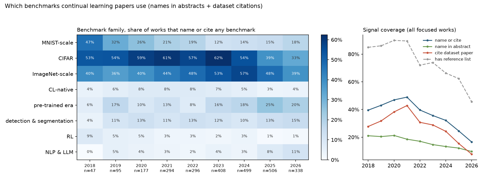
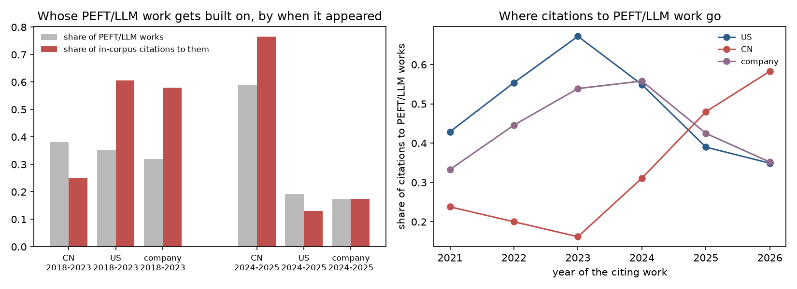

# Continual Learning Bibliometrics

How did continual learning research move from small vision benchmarks to large language models, and who drove that shift?

A reproducible bibliometric dataset of continual learning and catastrophic forgetting research, built from [OpenAlex](https://openalex.org), with every number traceable to a dated API snapshot.

## Findings (snapshot 2026-10-19)

- **US industry started the shift; China scaled it and now leads it.** Among PEFT/LLM works first seen in 2018-2023, US works got 60% of the field's in-corpus citations with 35% of the output, and works with a company author got 58% with 32%. Two papers carry much of that: Google's L2P and CODA-Prompt (Georgia Tech, IBM, Rice), both about prompting pre-trained vision transformers. Among 2024-2025 works, China writes 59% and gets 77% of the citations. Of the citations made to PEFT/LLM work in 2023, 67% went to US works; in 2026, 35%. See [Who drove the shift](#who-drove-the-shift-to-llms).
- **The field grew about 2.8x in three years.** Works where continual learning is the topic went from 756 first appearing in 2022 to 2,112 in 2025, and 2026 had already passed that (2,133) by October 19.
- **LLMs took over the growth.** The share of those works that use LLMs, foundation models or parameter-efficient tuning rose from 2.5% in 2019 to 29% in 2025 and 39% in 2026. Replay and regularization held steady at about 30% each. The PEFT/LLM tag scores F1 0.84 on a held-out sample.
- **China now writes half of it.** Among works with a known affiliation, China's share rose from 19% (2015-2019) to 53% (2023-2026), and the US share fell from 40% to 18%. OpenAlex's China attribution agrees with publisher affiliations in 99% of checked works. Industry co-authorship fell from 24% of works in 2019 to 8% in 2026, but PEFT/LLM works are 1.7x more likely than the rest to have a company author.
- **Benchmarks moved from MNIST to pre-trained models, and only lately to LLMs.** Among works that name or cite a benchmark, MNIST-scale datasets went from 47% in 2018 to 12% in 2023. Pre-trained-era benchmarks (ImageNet-R, CUB, DomainNet, VTAB) rose from 6% to 24% in 2025. Language benchmarks stayed at 4-6% through 2024 and reached 14% in 2026, but that's a floor: on a fresh validation sample the detector finds only about one in four language-benchmark papers. CIFAR stays the default throughout.
- **arXiv matters less than it did.** 57% of focused works were also on arXiv in 2019, against 38% in 2025. The broad corpus shows the same drop (54% -> 37%), so it isn't an artefact of the focus rule.
- **Brazil is marginal.** 32 focused works since 2015 (rank 30, under 0.5% of the field), led by UNICAMP and UFPE.
- **Keyword search over-collects.** 10-22% of works matched by the queries only mention continual learning in passing, depending on which labeller is asked. That's why all findings use a stricter focused corpus (precision 0.93-0.98 on held-out data).

None of these findings changes when works that exist only on deposit repositories such as Zenodo are put back in (see [Sensitivity](#sensitivity-repository-only-works)). Only the 2026 volume does.





## Status

| phase | question | state |
|---|---|---|
| F1 | How fast is the field growing, and how much of it lives on arXiv? | done |
| F2 | Which sub-areas drive the growth? | done: rule-based tags, validated on a held-out sample |
| F3 | Who collaborates with whom? Which institutions and countries are central? Where does Brazil sit? | done: countries, industry, institution network, Brazil; countries checked against Crossref |
| F4 | When did benchmarks migrate (Permuted MNIST -> Split CIFAR -> ImageNet-R -> LLM suites)? | done: abstract mentions + dataset citations, scored against three LLM labellers in two rounds; NLP & LLM recall 0.25 |
| F5 | Who drove the shift to LLMs and pre-trained models? | done: early adopters and in-corpus citation influence |

## Corpus

| step | works |
|---|---|
| raw OpenAlex results, all queries | 24,264 |
| in scope (field, type, not retracted, lifelong-learning gate) | 15,088 |
| after deduplication (662 preprint/published duplicates merged) | 14,426 |
| without repository-only works (1,000 removed) | 13,426 |
| focused: CL term in the title, or at least twice in the abstract | 9,326 |

Rules live in [`src/clbib/config.py`](src/clbib/config.py); the analysis corpus is defined once in [`src/clbib/corpus.py`](src/clbib/corpus.py).

- **Queries** (title + abstract): `"continual learning" | "catastrophic forgetting" | "class-incremental" | "task-incremental" | "domain-incremental"`, plus `"lifelong learning"` restricted to Computer Science.
- **Lifelong-learning gate.** Unrestricted, `"lifelong learning"` returns about 55k works, mostly adult education. Even inside Computer Science it's dominated by e-learning and MOOCs: of the 7,002 works found only by this query, 603 pass the gate (an ML term, and either an AI / Computer Vision subfield or no education term).
- **Scope.** Primary field in Computer Science, Engineering, Neuroscience or Mathematics; article, conference paper, preprint, review or book chapter; not retracted.
- **Deduplication.** OpenAlex doesn't merge every arXiv preprint with its published version. Remaining pairs are clustered by normalized title and first-author surname within three years. One record is kept per cluster (in scope > published > most cited), and `first_year` is the earliest appearance.
- **Repository-only works.** A work is dropped when every source it appears in, across all its OpenAlex locations and every record of its dedup cluster, is a general-purpose deposit repository (Zenodo, SSRN, Research Square, Preprints.org, OSF Preprints, Figshare, Authorea, Qeios, TechRxiv). These accept any upload without moderation. arXiv, bioRxiv/medRxiv and institutional repositories are kept, and so is any deposit that also appears in a journal, conference or on arXiv. Of the focused works removed this way, 410 are from 2026 and 26 from 2024.

### Growth

| first year | focused works | also on arXiv |
|---|---|---|
| 2017 | 45 | 56% |
| 2019 | 237 | 57% |
| 2022 | 756 | 51% |
| 2024 | 1,577 | 44% |
| 2025 | 2,112 | 38% |
| 2026 (to Oct 19) | 2,133 | 42% |

The 2026 arXiv share is probably inflated: many 2026 preprints haven't been matched to a published version yet. Full series: [`results/growth_by_year.csv`](results/growth_by_year.csv), [`results/growth_by_query.csv`](results/growth_by_query.csv).

### Recall

45 papers that a separate literature scout reported as continual learning (runs of 2026-10-06 to 2026-10-18) were looked up by arXiv DOI, then by normalised title. 40 (89%) are in the corpus and in scope, all 40 survive the repository rule, and 36 (80%) pass the focus rule. All 5 misses are indexed in OpenAlex but never use the query phrases ("continual learners", "forgetting" without "catastrophic"). The 4 papers lost to the focus rule are CL papers that name the field only once in the abstract. The check set was itself found by searching for CL, so these are upper bounds. List: [`validation/recall_check.csv`](validation/recall_check.csv); per-paper result: [`results/recall_check.csv`](results/recall_check.csv); `make recall` re-runs it.

## Sub-areas (F2)

[`src/clbib/subareas.py`](src/clbib/subareas.py) tags every focused work with plain regexes, so each tag can be audited. Tags are independent: a paper can be replay + PEFT/LLM + medical.

- method: replay, regularization, architecture, optimization, PEFT/LLM, plasticity
- study type: theory, survey/benchmark
- setting: online, federated, RL
- domain: application outside ML

Share of focused works (with an abstract) per tag, for the tags that pass validation:

| first year | works | PEFT/LLM | replay | regularization | RL | federated |
|---|---|---|---|---|---|---|
| 2019 | 202 | 2.5% | 24% | 26% | 12% | 0.5% |
| 2022 | 650 | 7.1% | 32% | 29% | 6.0% | 3.2% |
| 2024 | 1,327 | 23% | 31% | 26% | 4.8% | 6.1% |
| 2025 | 1,795 | 29% | 30% | 29% | 4.2% | 6.7% |
| 2026 | 1,619 | 39% | 34% | 31% | 5.7% | 6.0% |

Full series: [`results/subarea_by_year.csv`](results/subarea_by_year.csv).

## Who: countries, industry, institutions (F3)

[`src/clbib/networks.py`](src/clbib/networks.py) uses OpenAlex affiliations, whole counting (a CN-US paper counts for both). 61-90% of focused works per year since 2018 have at least one known country ([`results/coverage_by_year.csv`](results/coverage_by_year.csv)); shares below are over those works.



| country | works 2015-2026 | 2015-2019 | 2020-2022 | 2023-2026 |
|---|---|---|---|---|
| China | 3,652 | 19% | 31% | 53% |
| United States | 1,633 | 40% | 30% | 18% |
| United Kingdom | 502 | 9.7% | 8.7% | 5.8% |
| Italy | 340 | 3.5% | 6.3% | 4.0% |
| Germany | 338 | 7.1% | 6.3% | 3.7% |
| South Korea | 337 | 7.7% | 5.5% | 3.9% |
| India | 336 | 1.9% | 4.2% | 4.5% |
| Brazil (rank 30) | 32 | 0.3% | 0.3% | 0.5% |

- **Industry.** Works with at least one company author: 24% in 2019, 15% in 2023, 8% in 2026. In 2023-2026, 16% of PEFT/LLM works have a company author against 9% of the rest. China (1.2x) and Hong Kong (2.2x) are also over-represented in PEFT/LLM work ([`results/peft_llm_by_country.csv`](results/peft_llm_by_country.csv)).
- **International co-authorship** is flat at about 25% of works since 2018.
- **Institution network.** 2,777 institutions linked by co-authored works (11,441 links; works with more than 20 institutions skipped). 81% sit in one connected component. Louvain finds 22 communities (modularity 0.52) that mostly follow geography: a US-led cluster, three Chinese ones (around Tsinghua, the Chinese Academy of Sciences and Peking University), a French one, an Australian one and one around Singapore and Hong Kong. Mid-sized clusters mix countries, such as the US, Italy, Germany and Spain, or Germany, the US and Canada ([`results/institution_communities.csv`](results/institution_communities.csv), [`results/institution_centrality.csv`](results/institution_centrality.csv)).
- **Authors.** 24,950 authors, but only 37% fall in the largest connected component: most groups publish in isolation ([`results/network_summary.csv`](results/network_summary.csv)).
- **Brazil.** 32 works: UNICAMP (5), UFPE (4), then one or two each from 24 other institutions. 18 of the 32 appeared in 2025-2026. The most cited is PODNet (UNICAMP with French partners, 710 citations). All three Brazilian PEFT/LLM works are from 2026, two of them from PUCRS. Full list: [`results/brazil_works.csv`](results/brazil_works.csv).

### Are the countries right?

[`src/clbib/country_validate.py`](src/clbib/country_validate.py) checks OpenAlex's country codes against an independent source: the raw affiliation strings publishers deposit in Crossref (e.g. "Hunan University, Changsha, China"). Three LLM labellers (Claude Opus 5.5, Claude Sonnet 5.5, DeepSeek V4 Flash) turn each work's strings into countries without seeing the OpenAlex codes, and the majority vote is the reference.

The population is focused works from 2018-2026 with a non-arXiv DOI (6,526, of which 93% have an OpenAlex country). 300 works with a country and 200 without were drawn; 164 and 30 of them have affiliations in Crossref and were labelled.

| country | Crossref positives | precision | recall |
|---|---|---|---|
| China | 91 | 0.99 | 0.99 |
| United States | 21 | 0.86 | 0.90 |
| India | 12 | 1.00 | 1.00 |
| Singapore | 14 | 1.00 | 1.00 |
| United Kingdom | 7 | 1.00 | 1.00 |
| Hong Kong | 5 | 0.71 | 1.00 |
| Germany | 3 | 0.75 | 1.00 |

- When OpenAlex gives a work a country, it's almost always right: the full set of the 14 tracked countries matches exactly in 94% of works. The errors that do occur are mostly extra countries that Crossref doesn't list (3 for the US, 2 for Hong Kong, 1 for Germany), plus 2 missed US affiliations.
- Works without an OpenAlex country have a different mix. China is on 23% of them (7 of 30, 95% CI 12-41%) against 55% of works with a country. In this population they are only 7% of works, so filling them in would move China's share from 55% to about 53%. The bias is real but small here.
- What this can't check: arXiv-only works, where missing affiliations are more common, and publishers that don't deposit affiliations in Crossref (mostly IEEE, Springer and Elsevier do). If the missing part of arXiv looks like the missing part checked here, China's 53% overstates its share by a few points.
- The labellers agree with each other almost perfectly (kappa 0.91 or higher for every country), so the reference isn't model-dependent.

Full tables: [`results/country_validation.csv`](results/country_validation.csv), [`results/country_validation_agreement.csv`](results/country_validation_agreement.csv).

## Benchmarks (F4)

[`src/clbib/benchmarks.py`](src/clbib/benchmarks.py) marks a work as using a benchmark when its abstract names it or it cites the paper that introduced the dataset (20 benchmarks in 8 families). Method papers that also popularised a split, like Matching Networks for mini-ImageNet, are mention-only, because they are cited mostly for the method.



Since 2018, only 17-49% of works per year name or cite any benchmark, and the share falls after 2021 because OpenAlex reference lists thin out (46% of 2026 works have one). So the table reports the **mix**: among works that name or cite a benchmark, the share in each family. The mention-only column checks that a trend isn't produced by the shrinking citation signal.

| family | 2018 | 2021 | 2023 | 2025 | 2026 | 2026, mention only |
|---|---|---|---|---|---|---|
| works with a benchmark | 47 | 297 | 415 | 513 | 350 | 209 |
| MNIST-scale | 47% | 21% | 12% | 15% | 17% | 22% |
| CIFAR | 53% | 60% | 61% | 38% | 31% | 53% |
| ImageNet-scale | 40% | 44% | 53% | 47% | 37% | 22% |
| pre-trained era (ImageNet-R, CUB, DomainNet, VTAB) | 6.4% | 12% | 16% | 24% | 20% | 14% |
| NLP & LLM | 0% | 4.0% | 6.3% | 9.4% | 14% | 21% |

- The MNIST decline (2018-2023) and the late arrival of language benchmarks hold under both signals.
- CIFAR's drop after 2024 appears only with citations; by mentions it stays above 50%, so it's a coverage effect, not a real decline.
- MNIST-scale climbs back to 17-22% in 2026. It survives the repository filter, so it isn't Zenodo noise, but it isn't explained yet and isn't interpreted.
- Language benchmarks (14% in 2026) lag the PEFT/LLM tag (39% of 2026 works) partly because many of those papers apply prompts or adapters to pre-trained vision models and evaluate on vision benchmarks, and partly because the detector still misses about three in four language datasets (see below).

Spot-check snippets for every benchmark: [`results/benchmark_audit.csv`](results/benchmark_audit.csv). Mention and citation counts: [`results/benchmark_signals.csv`](results/benchmark_signals.csv).

### Does the detector find the benchmarks?

[`src/clbib/benchmark_validate.py`](src/clbib/benchmark_validate.py) asks the same three LLM labellers which benchmark families each paper's title and abstract use, without showing them the detector's output. The sample is 150 works where the abstract names a benchmark and 150 where it doesn't (focused, 2018-2026, with an abstract; seed 20261021). Scores are re-weighted by stratum size (1,207 vs 6,384 works), so recall estimates the corpus-level value. Only the mention signal (title + abstract) is scored, since the labellers can't see reference lists. The detector was frozen in commit `8381df9` before any label existed.

| family | sample positives | precision | recall (95% CI) |
|---|---|---|---|
| MNIST-scale | 37 | 1.00 | 0.97 (0.91-1.00) |
| CIFAR | 91 | 1.00 | 0.92 (0.87-0.98) |
| ImageNet-scale | 52 | 0.95 | 1.00 |
| pre-trained era | 25 | 1.00 | 1.00 |
| detection & segmentation | 17 | 1.00 | 0.47 (0.24-1.00) |
| CL-native | 10 | 1.00 | 0.49 (0.18-1.00) |
| RL | 5 | 1.00 | 0.43 (0.09-1.00) |
| NLP & LLM | 23 | 1.00 | 0.19 (0.09-0.37) |

- The vision families that carry the MNIST -> CIFAR -> pre-trained story are detected reliably, so that part of the trend stands.
- Precision is near 1 everywhere: when the detector names a family, the paper uses it.
- NLP & LLM recall of this first detector is about 0.19. Language CL papers use a long tail of task datasets (ACE and MAVEN for event detection, COCO captions, instruction-tuning streams, new benchmarks built by the paper) that a fixed list of 20 benchmarks doesn't cover. Round 2 below extends the list.
- Labellers agree with each other at kappa 0.96 or higher on MNIST-scale, CIFAR, ImageNet-scale and pre-trained era, and 0.74-0.76 for DeepSeek against the two Claude models on CL-native, RL and NLP & LLM.

Full tables: [`results/benchmark_validation.csv`](results/benchmark_validation.csv), [`results/benchmark_validation_agreement.csv`](results/benchmark_validation_agreement.csv).

#### Round 2: NLP & LLM on a fresh sample

Round 1 showed the problem, and its 11 missed language papers were read to design the fix, so it can't also test the fix. [`src/clbib/nlp_validate.py`](src/clbib/nlp_validate.py) scores the extended detector on 300 new works (none from round 1), drawn in three strata of 100: works the extended detector flags as NLP & LLM (269 in the population), unflagged works with the PEFT/LLM tag (1,440) and the rest (5,582). Same guide, same three labellers, majority vote, stratum-weighted scores. The test, the sample design and the decision rule were committed before any label existed ([`validation/nlp_round2_prereg.md`](validation/nlp_round2_prereg.md)).

| detector | precision (95% CI) | recall (95% CI) |
|---|---|---|
| round 1 (20 named benchmarks) | 1.00 | 0.14 (0.07-0.24) |
| layer 1: + six groups of named language datasets | 0.98 (0.92-1.00) | 0.25 (0.16-0.41) |
| layer 1 + 2: + "names an acronym-like dataset in a language paper" | 0.68 (0.59-0.77) | 0.42 (0.28-0.68) |

- The pre-registered rule admitted layer 2 only at precision 0.85 or higher. It reached 0.68, so the findings use layer 1.
- Layer 1 almost doubles recall at no cost in precision, but three in four language-benchmark papers are still missed. The NLP & LLM shares above stay a lower bound, now a less severe one.
- Labeller agreement on NLP & LLM: kappa 0.90 between the two Claude models, 0.62-0.66 against DeepSeek.

Full table: [`results/nlp_validation_round2.csv`](results/nlp_validation_round2.csv).

## Who drove the shift to LLMs

[`src/clbib/drivers.py`](src/clbib/drivers.py) looks at the works carrying the PEFT/LLM tag (held-out F1 0.84) and asks two things: who wrote them, and whose work the field built on. Influence is measured with in-corpus citations: a focused work citing a PEFT/LLM work that is also in the corpus. Preprint and published versions are merged through the dedup clusters first. Shares use whole counting over works with a known country, and "company" means at least one company-affiliated author.



**Who wrote it.** Before the wave (first year 2018-2023, 191 PEFT/LLM works with a known country), China and the US wrote about the same share (38% and 35%), each slightly above its share of other CL work. The clear over-representation was industry: 32% of early PEFT/LLM works had a company author, against 17.5% of other works (1.8x). The institutions with the most early PEFT/LLM works are Tsinghua (12), the Chinese Academy of Sciences (11), Peking University (10), Amazon (8) and Huawei (7) ([`results/drivers_early_institutions.csv`](results/drivers_early_institutions.csv)).

**Whose work got built on.** Citation shares are computed separately for each cohort, so old works aren't favoured over new ones. Works first seen in 2026 are left out: they have 22 in-corpus citations in total.

| cited works | group | share of works | share of citations (95% CI) | age-adjusted | without top 2 |
|---|---|---|---|---|---|
| 2018-2023 (1,732 citations) | US | 35% | 60% (36-75%) | 55% | 43% |
| | company author | 32% | 58% (33-75%) | 54% | 40% |
| | China | 38% | 25% (14-44%) | 30% | 36% |
| 2024-2025 (834 citations) | China | 59% | 77% (66-85%) | 73% | 72% |
| | US | 19% | 13% (7-22%) | 18% | 16% |
| | company author | 17% | 18% (10-27%) | 18% | 21% |

- The early cited base is US industry. L2P (Google, 2022, 353 in-corpus citations) and CODA-Prompt (Georgia Tech, IBM, Rice, 2023, 168) are the two most cited PEFT/LLM works in the corpus. Without them, US and company works still get more citations than their share of works (43% and 40%), so it isn't only two papers. Both are about prompts on pre-trained vision transformers, which fits the benchmark finding that the pre-trained era started on vision benchmarks.
- The 2024-2025 cited base is Chinese, and that also holds without the top two. The most cited works are EASE (Nanjing University), MoE-Adapters (Dalian, Tsinghua, UESTC) and InfLoRA. Company authors are cited in line with their share of works: industry no longer leads.
- By citing year, the share of citations to PEFT/LLM work going to US works peaked at 67% in 2023 and fell to 35% in 2026, while China's rose from 16% to 58% ([`results/drivers_citing_year.csv`](results/drivers_citing_year.csv)).

Most cited PEFT/LLM works with their institutions: [`results/drivers_top_cited.csv`](results/drivers_top_cited.csv). Full tables: [`results/drivers_adopters.csv`](results/drivers_adopters.csv), [`results/drivers_influence.csv`](results/drivers_influence.csv).

Limits of this measure: only citations between works in the corpus count, so influence from outside continual learning (the LLM papers themselves, LoRA, CLIP) isn't measured. Reference lists thin out after 2021, so recent citing years are a sample. The early cohort is small and the intervals are wide. Some top-cited works carry the PEFT/LLM tag only because they adapt a pre-trained model (e.g. *Continual Test-Time Domain Adaptation*), which is within the tag's definition but not LLM work.

## Validation of the sub-area tags (F2)

The rules were scored against three LLM labellers (Claude, DeepSeek V4 Flash, Claude Sonnet 5) on two disjoint samples of 150 works. The rules were tuned on the dev sample, frozen in commit `098968f`, then scored once on the test sample. None of the labellers saw the rules. There is no human gold set, so these scores measure agreement with models.

Held-out F1 by tag:

| tag | support | Claude | DeepSeek | Sonnet | used for findings |
|---|---|---|---|---|---|
| federated | 5 | 0.91 | 0.93 | 0.93 | yes, but rare |
| rl | 12 | 0.86 | 0.88 | 0.83 | yes |
| peft_llm | 28 | 0.84 | 0.77 | 0.84 | yes |
| regularization | 43 | 0.74 | 0.78 | 0.82 | yes |
| replay | 40 | 0.78 | 0.73 | 0.73 | yes |
| application | 31 | 0.63 | 0.68 | 0.69 | no |
| online | 18 | 0.68 | 0.64 | 0.62 | no |
| survey_benchmark | 14 | 0.42 | 0.57 | 0.60 | no, undercounts |
| architecture | 37 | 0.54 | 0.44 | 0.48 | no, undercounts |
| theory | 4 | 0.29 | 0.22 | 0.18 | no, dev score was overfit |

A tag is used for findings only if its test F1 is at least 0.7 under all three labellers. The split doesn't depend on which model wrote the labels. Pairwise kappa between labellers is 0.83 or higher on the five tags used. Supports are small, so differences of a few points are noise.

Corpus precision, dev scores and full agreement tables: [`validation/README.md`](validation/README.md). Country (F3) and benchmark (F4) checks are in their own sections above.

## Sensitivity: repository-only works

The repository rule was added after the 2026 anomaly was spotted, so it isn't pre-registered. Before the rule, 319 of 2,543 focused 2026 works were Zenodo deposits (3 in 2024), 45% of them by ten authors, with a median of one author and 2% citing anything. To show the rule doesn't drive the findings, `make sensitivity` re-runs every analysis with those works kept:

| metric | main | with repository-only works |
|---|---|---|
| focused works, 2025 | 2,112 | 2,207 |
| focused works, 2026 (partial) | 2,133 | 2,543 |
| growth 2022 -> 2025 | 2.8x | 2.9x |
| PEFT/LLM share, 2026 | 39% | 39% |
| China share, 2023-2026 | 53% | 53% |
| company author, PEFT/LLM vs rest | 1.67x | 1.66x |
| benchmark mix: MNIST-scale, 2026 | 17% | 19% |
| benchmark mix: NLP & LLM, 2026 | 14% | 18% |

Every metric keeps its direction; the largest change is the 2026 volume (-16%). Full table (25 metrics): [`results/sensitivity.csv`](results/sensitivity.csv). The sample used for validation was drawn before the rule and includes 14 repository-only works out of 300, so the precision and F1 above describe a slightly broader corpus.

## Reproduce

```bash
python3.11 -m venv .venv && .venv/bin/pip install -r requirements.txt
export OPENALEX_API_KEY=...   # free key, https://openalex.org/settings/api
make all                       # fetch -> clean -> growth -> subareas -> validate -> networks -> benchmarks -> drivers -> sensitivity
make test
```

No API key? Download `cl-bibliometrics-processed-2026-10-19.zip` from [release v1.0.0](https://github.com/ArthurFachel/cl-bibliometrics/releases/tag/v1.0.0), unzip it at the repo root, and run any target except `fetch` and `clean`. A 3-page summary is in [`docs/report.pdf`](docs/report.pdf) (`make report` rebuilds it).

Raw API pages are kept gzipped under `data/raw/openalex/<query>/` with a manifest (filter, counts, fetch date). `data/` isn't versioned; `results/`, `figures/` and the label files in `validation/` are.

```
src/clbib/
  config.py       corpus definition: queries, scope, focus rule, repository list, paths
  corpus.py       the analysis corpus filter, used by every analysis
  fetch.py        OpenAlex cursor pagination, resumable
  clean.py        parquet tables (works, authorships, references) and dedup
  growth.py       F1 tables and figure
  recall.py       recall check against 45 scout-confirmed papers
  subareas.py     F2 rule-based tags
  validate.py     sample drawing and rule scoring
  llm_label.py    LLM labellers and pairwise agreement
  networks.py     F3 countries, industry, institution and author networks
  benchmarks.py   F4 benchmark mentions and dataset citations
  drivers.py      F5 early adopters and citation influence of PEFT/LLM work
  country_validate.py    F3 check: OpenAlex countries vs Crossref affiliations
  benchmark_validate.py  F4 check: benchmark detector vs LLM labellers
  nlp_validate.py        F4 round 2: NLP & LLM detector on a fresh sample
  sensitivity.py  headline numbers with and without repository-only works
tests/            parsing, dedup, tag rules, benchmark regexes, network building
validation/       samples, label files and labelling guide
```

## Limitations

- Retrieval is keyword-based. Papers that never say "continual learning" or "catastrophic forgetting" (e.g. "model editing", "incremental learning" alone) are missed.
- Sub-area validation uses LLM labels only. Agreement across three labellers makes the tags more credible, but it isn't a human gold standard.
- OpenAlex fields, topics and institution data are machine-assigned. Affiliations are missing for 10-39% of works per year, more often on arXiv, and author disambiguation is OpenAlex's.
- Benchmarks are only visible when an abstract names them or a reference list exists; most papers show neither. Even when the abstract names one, the detector misses about three in four language datasets (round-2 recall 0.25).
- The country check covers only works with a non-arXiv DOI and Crossref affiliations, and only 30 works without an OpenAlex country.
- The repository rule is source-based. It can't catch low-quality work posted on arXiv, and it drops a legitimate paper that only exists on Zenodo.
- 2026 is a partial year.

## Author

Arthur Fachel, Data Analytics @ PUCRS, MALTA Lab. Research on neuron-level plasticity for continual learning.

## License

Code: MIT. Data: OpenAlex metadata is CC0.
